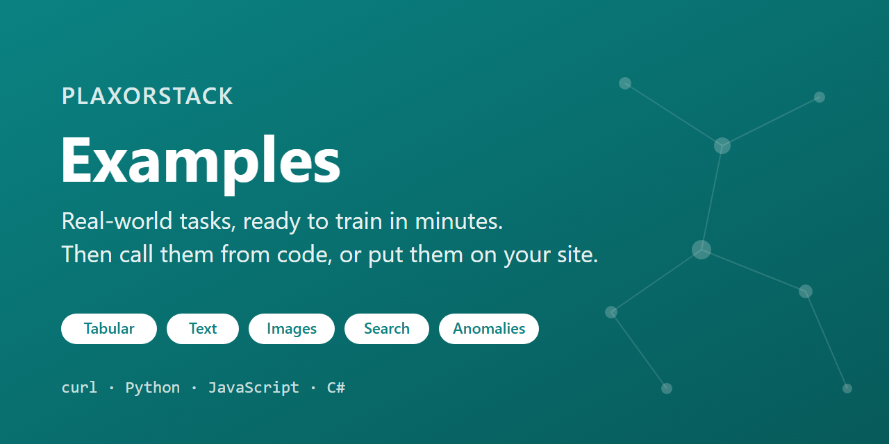

# PlaxorStack examples

Ready-to-train datasets and step-by-step walkthroughs for every kind of model you can build on
[PlaxorStack](https://plaxorstack.com) — from uploading a file to calling the model from your own
code or putting it on your website as a chat widget.

Each example is a real-world task. Pick the one closest to your problem, train it in a few minutes,
then swap in your own data.

## What can I build?

| I want to… | Task type | Example | Data | Video |
|---|---|---|---|---|
| Predict a **number** — demand, price, duration | Regression | [Forecast bike rentals](tabular/forecast-bike-rentals) | 17,379 hours of a real bike-share scheme | [▶ Episode 1](https://youtu.be/OKsQ7nYeuSg) |
| **Forecast the next days** of a number from its own history | Time-series forecasting | [Forecast bakery sales](tabular/forecast-bakery-sales) | 21 months of daily sales, 3 shops | |
| Answer a **yes/no** question about a customer or event | Binary classification | [Predict an online purchase](tabular/predict-online-purchase) | 12,330 real web-shop sessions | [▶ Episode 4](https://youtu.be/6mEzXtea63M) |
| Put something into **one of several categories** | Multiclass classification | [Grade beans by variety](tabular/grade-beans-by-variety) | 13,611 measured beans, 7 varieties | |
| Find **natural groups** with no labels at all | Clustering | [Segment wholesale customers](tabular/segment-wholesale-customers) | 440 real wholesale customers | |
| Suggest **what a user will like** next | Recommendation | [Recommend products](tabular/recommend-products) | 4,509 ratings by 250 customers | |
| **Order a list** so the best results come first | Ranking | [Rank hotel search results](tabular/rank-hotel-search-results) | 500 searches × 8 hotels | |
| **Spot the unusual** without labelling a single example | Anomaly detection | [Spot unusual server load](tabular/spot-unusual-server-load) | A week of server monitoring, 2,016 readings | |
| Sort **free text or documents** (PDF, Word) into categories | Text classification | [Route support tickets](text/route-support-tickets) | 320 customer tickets, 4 teams | [▶ Episode 5](https://youtu.be/wV__9bclcOQ) |
| | Text classification | [Filter spam messages](text/filter-spam-messages) | 5,574 real SMS messages | |
| Tag text with **every topic that applies** | Multi-label text classification | [Tag product reviews](text/tag-product-reviews) | 600 clothing-shop reviews, 5 topics | |
| **Search by meaning**, not keywords | Semantic search | [Answer questions from your FAQ](text/answer-questions-from-faq) | 48 help-centre articles | [▶ Episode 2](https://youtu.be/1hb_Bf4VFh4) |
| Recognise what is in a **photo** | Image classification | [Detect leaf disease](image/detect-leaf-disease) | 252 field photos of bean leaves | [▶ Episode 3](https://youtu.be/DNJuX3Q62iE) |
| Give a photo **every tag that applies** | Multi-label image classification | [Tag property photos](image/tag-property-photos) | 268 real-estate photos, 11 tags | ▶ Episode 7 (soon) |
| | Multi-label image classification | [Tag fabric swatches](image/tag-fabric-swatches) | 480 swatches, 6 colours and 3 patterns | |

Every example works on the **free trial**. The trial holds one model at a time, so delete it
before you train the next example (AI Board → the model → Delete).

## Watch the series

Short videos that walk through the examples above, start to finish, with no code:
[the PlaxorStack playlist](https://www.youtube.com/@PlaxorStack) ·
[plaxorstack.com/videos](https://plaxorstack.com/videos).
Start with [Your own AI, explained](https://youtu.be/vzBRToCQius).

| Episode | Example |
|---|---|
| [1 · Predict demand](https://youtu.be/OKsQ7nYeuSg) | [Forecast bike rentals](tabular/forecast-bike-rentals) |
| [2 · Answer customers from your FAQ](https://youtu.be/1hb_Bf4VFh4) | [Answer questions from your FAQ](text/answer-questions-from-faq) |
| [3 · Recognise photos](https://youtu.be/DNJuX3Q62iE) | [Detect leaf disease](image/detect-leaf-disease) |
| [4 · Will this visitor buy?](https://youtu.be/6mEzXtea63M) | [Predict an online purchase](tabular/predict-online-purchase) |
| [5 · Route tickets, and act on them](https://youtu.be/wV__9bclcOQ) | [Route support tickets](text/route-support-tickets) · [Act on predictions](integrations/act-on-predictions) |
| [6 · Your model inside your AI assistant](https://youtu.be/3KF3EnXu1iY) | [MCP on the Developers page](https://plaxorstack.com/developers#mcp) |
| 7 · Several tags on one photo (soon) | [Tag property photos](image/tag-property-photos) |
| 8 · Connect your own site or system (soon) | [Getting started](getting-started) · [Server proxy](server-proxy) · [Website widget](integrations/website-widget) |

## Quick start

1. Read **[Getting started](getting-started)** once: account, keys, model ids and what the API returns.
2. Open an example and follow its README. Each takes about ten minutes:
   - download the file in its `data/` folder,
   - upload it and match its columns,
   - train,
   - try a prediction in the browser.
3. Call your model from the `api/` folder in the language you like:

   | Language | Run |
   |---|---|
   | curl | `sh predict.sh` |
   | Python 3 | `python predict.py` (needs `pip install requests`) |
   | JavaScript (Node 18+) | `node predict.mjs` |
   | C# (.NET 10) | `dotnet run predict.cs` |

   Every script reads the same two environment variables:

   ```sh
   export PLAXOR_API_KEY="your API key"       # PowerShell: $env:PLAXOR_API_KEY = "..."
   export PLAXOR_MODEL_ID="1234"              # the number after "Model #"
   ```

4. To see a model answer questions on a web page, open the `widget/` folder of
   [bike rentals](tabular/forecast-bike-rentals/widget) or [leaf disease](image/detect-leaf-disease/widget).

## Going further

| | |
|---|---|
| [Call the API from your own server](server-proxy) | A web page that uses a model **without exposing your API key**. Express and ASP.NET. |
| [Integrations](integrations) | Batch-score a CSV, route Zendesk/Freshdesk tickets, the widget on Shopify/WordPress, Zapier and Make. |
| [Act on predictions](integrations/act-on-predictions) | **Actions**: a PDF of a batch's matching rows, a signed webhook to your system, an app or your own MCP server — run at once or asked first in the chat. |
| [Use your models from an AI assistant](https://plaxorstack.com/developers#mcp) | Claude Code, Claude Desktop or any MCP client calls your models as tools with an API key, one prediction per call. With *Allow proposals* on the key, it can also **propose** your actions — they wait on the Approvals page and run only when the subscription's owner or an admin approves them. Connectors that cannot take a key, such as claude.ai and ChatGPT, [sign in instead](https://plaxorstack.com/developers#mcp-sign-in): add `https://api.plaxorstack.com/mcp`, sign in, and choose one subscription. Disconnect them under *Settings › MCP › Connected AI apps*. |
| [Going to production](production) | Keys and rotation, retries on 429, batches that partly fail, quotas, retraining, judging a model. |

## Repository layout

```
getting-started/          keys, model ids, responses, errors, limits
tabular/<example>/        README.md · data/ · api/ · widget/ (some)
text/<example>/           README.md · data/ · api/
image/<example>/          README.md · data/ · api/ · widget/
server-proxy/             the browser calls your server, your server holds the key
integrations/             CSV batch scoring, help desks, website platforms, Zapier/Make, actions
production/               the checklist before going live
tools/DatasetBuilder/     rebuilds every data/ folder from its public source
```

## Where the data comes from

Seven datasets are real and come from public sources: UCI Machine Learning Repository, Makerere
University's AI Lab and Wikimedia Commons (the property photos, each credited in its
`data/CREDITS.md`). Eight were written for these examples, because no openly licensed data of
that kind could be redistributed. Every source, licence and change is listed in
[DATA-LICENSES.md](DATA-LICENSES.md). To rebuild them yourself, run
`dotnet run --project tools/DatasetBuilder`.

## Contributing and security

Fixes and new examples are welcome: see [CONTRIBUTING.md](CONTRIBUTING.md). To report a security
problem, or if you've leaked a key, see [SECURITY.md](SECURITY.md).

## License

Code: [MIT](LICENSE). Datasets keep their source's licence — see [DATA-LICENSES.md](DATA-LICENSES.md).
