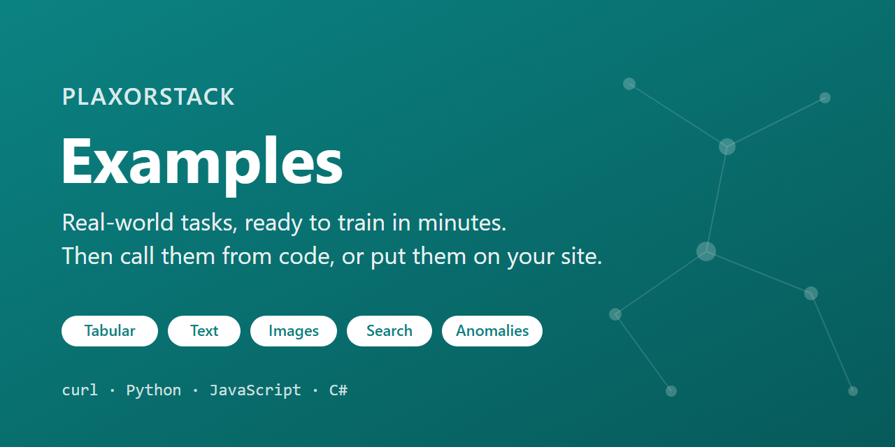

# PlaxorStack examples

Ready-to-train datasets and step-by-step walkthroughs for every kind of model you can build on
[PlaxorStack](https://plaxorstack.com) — from uploading a file to calling the model from your own
code or putting it on your website as a chat widget.

Each example is a real-world task. Pick the one closest to your problem, train it in a few minutes,
then swap in your own data.

## What can I build?

| I want to… | Task type | Example | Data |
|---|---|---|---|
| Predict a **number** — demand, price, duration | Regression | [Forecast bike rentals](tabular/forecast-bike-rentals) | 17,379 hours of a real bike-share scheme |
| Answer a **yes/no** question about a customer or event | Binary classification | [Predict an online purchase](tabular/predict-online-purchase) | 12,330 real web-shop sessions |
| Put something into **one of several categories** | Multiclass classification | [Grade beans by variety](tabular/grade-beans-by-variety) | 13,611 measured beans, 7 varieties |
| Find **natural groups** with no labels at all | Clustering | [Segment wholesale customers](tabular/segment-wholesale-customers) | 440 real wholesale customers |
| Suggest **what a user will like** next | Recommendation | [Recommend products](tabular/recommend-products) | 4,509 ratings by 250 customers |
| **Order a list** so the best results come first | Ranking | [Rank hotel search results](tabular/rank-hotel-search-results) | 500 searches × 8 hotels |
| **Spot the unusual** without labelling a single example | Anomaly detection | [Spot unusual server load](tabular/spot-unusual-server-load) | A week of server monitoring, 2,016 readings |
| Sort **free text** into categories | Text classification | [Route support tickets](text/route-support-tickets) | 320 customer tickets, 4 teams |
| | Text classification | [Filter spam messages](text/filter-spam-messages) | 5,574 real SMS messages |
| Tag text with **every topic that applies** | Multi-label text classification | [Tag product reviews](text/tag-product-reviews) | 600 clothing-shop reviews, 5 topics |
| **Search by meaning**, not keywords | Semantic search | [Answer questions from your FAQ](text/answer-questions-from-faq) | 48 help-centre articles |
| Recognise what is in a **photo** | Image classification | [Detect leaf disease](image/detect-leaf-disease) | 252 field photos of bean leaves |

Every example works on the **free trial**. The trial holds two models at once, so delete one
before you train a third (AI Board → the model → Delete).

## Quick start

1. Read **[Getting started](getting-started)** once: account, keys, model ids and what the API returns.
2. Open an example and follow its README. Each takes about ten minutes:
   - download the file in its `data/` folder,
   - upload it and match its columns,
   - train,
   - try a prediction in the browser.
3. Call your model from the `api/` folder in the language you like:

   | Language | Run |
   |---|---|
   | curl | `sh predict.sh` |
   | Python 3 | `python predict.py` (needs `pip install requests`) |
   | JavaScript (Node 18+) | `node predict.mjs` |
   | C# (.NET 10) | `dotnet run predict.cs` |

   Every script reads the same two environment variables:

   ```sh
   export PLAXOR_API_KEY="your API key"       # PowerShell: $env:PLAXOR_API_KEY = "..."
   export PLAXOR_MODEL_ID="1234"              # the number after "Model #"
   ```

4. To see a model answer questions on a web page, open the `widget/` folder of
   [bike rentals](tabular/forecast-bike-rentals/widget) or [leaf disease](image/detect-leaf-disease/widget).

## Going further

| | |
|---|---|
| [Call the API from your own server](server-proxy) | A web page that uses a model **without exposing your API key**. Express and ASP.NET. |
| [Integrations](integrations) | Batch-score a CSV, route Zendesk/Freshdesk tickets, the widget on Shopify/WordPress, Zapier and Make. |
| [Going to production](production) | Keys and rotation, retries on 429, batches that partly fail, quotas, retraining, judging a model. |

## Repository layout

```
getting-started/          keys, model ids, responses, errors, limits
tabular/<example>/        README.md · data/ · api/ · widget/ (some)
text/<example>/           README.md · data/ · api/
image/<example>/          README.md · data/ · api/ · widget/
server-proxy/             the browser calls your server, your server holds the key
integrations/             CSV batch scoring, help desks, website platforms, Zapier/Make
production/               the checklist before going live
tools/DatasetBuilder/     rebuilds every data/ folder from its public source
```

## Where the data comes from

Six datasets are real and come from public sources: UCI Machine Learning Repository and Makerere
University's AI Lab. Six were written for these examples, because no openly licensed data of
that kind could be redistributed. Every source, licence and change is listed in
[DATA-LICENSES.md](DATA-LICENSES.md). To rebuild them yourself, run
`dotnet run --project tools/DatasetBuilder`.

## Contributing and security

Fixes and new examples are welcome: see [CONTRIBUTING.md](CONTRIBUTING.md). To report a security
problem, or if you've leaked a key, see [SECURITY.md](SECURITY.md).

## License

Code: [MIT](LICENSE). Datasets keep their source's licence — see [DATA-LICENSES.md](DATA-LICENSES.md).
