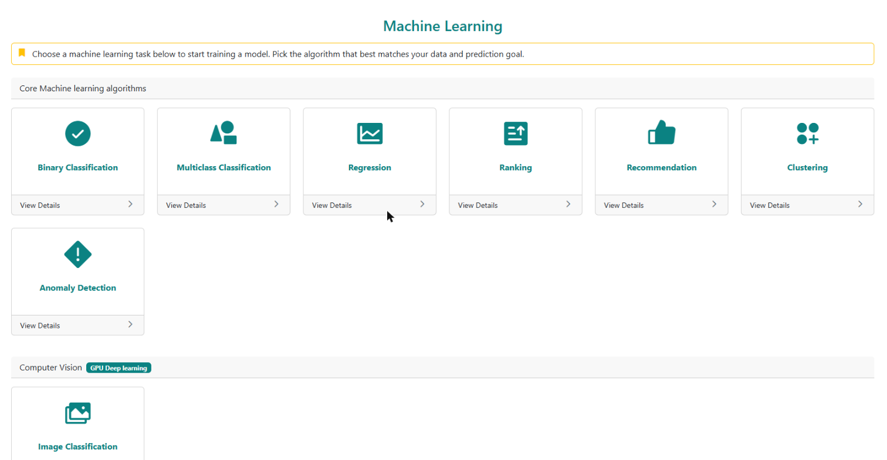
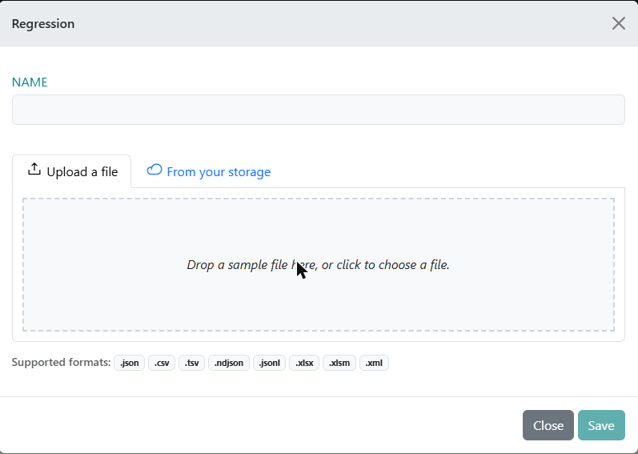

# Getting started

Everything the examples have in common, once. Read this before your first example. Five minutes.

## 1. The three steps of every example

```
 your file ──► upload & match columns ──► train ──► model #1234 ──► API  (your code)
                                                              └──► widget (your web page)
```

1. **Upload.** Go to **Machine Learning** (`/MachineLearning`) and click the card for the task type.
   Give the training a name, drop the file in, then **drag each column of your file (left) onto the
   field it plays (right)**. That step is called *mapping*. **Save** turns on once every required
   field has a column.

   

   

2. **Train.** Open the training from **Trainings** (`/Trainings`). It first imports and checks your
   data; when it's ready, go to the **Algorithms** tab and click **Actions → Train**. The row says
   **Trained** when it's done, and **Predict** lets you try it right there in the browser.
3. **Use.** Every trained model has a number, shown as **Model #1234**. Your code sends that number
   with each request.

Images and text have their own cards: **Image Classification** under *Computer Vision*, and
**Text Classification**, **Multi-label Text** and **Semantic Search** under *Natural Language
Processing*. An image ZIP or a folder-per-category text ZIP needs no mapping. A text CSV maps its
text column to **Text** and its category column to **Label**; a search index maps **Text** and
**Id**. Their pages have a **Training run** tab, where you start the run (choosing a pretrained
encoder or *from scratch* in a dialog), and a **Prediction** tab. They train on a GPU.

## 2. Mapping: the fields a tabular model has

A tabular model (regression, classification, clustering, ranking, recommendation, anomaly detection) learns from fields
with fixed names. Your columns can be called anything — mapping says which is which.

| Field | Meaning |
|---|---|
| **Label** | What the model predicts: the number, the yes/no, the category, the rating or relevance. Clustering and anomaly detection have none. |
| **Features** | First input. A number, or text. |
| **Features2** | Second input, a number. |
| **Category** | Second input, a word (a type, a city, a plan). For recommendation, the item. |
| **ForUser** | Ranking: which rows belong to one list (one search, one session). Recommendation: the user. |

> **Two inputs per tabular model.** Today a tabular model learns from at most two columns: Features
> plus Features2, or Features plus Category. That's why every tabular example here uses exactly two.
> Pick the two columns that matter most; the data analysis after upload helps you choose.

Columns you don't map are ignored, so you don't need to delete them from your file.

## 3. Keys

Create keys at **Secrets** (`/secrets`) in the menu. There are two kinds, and they're not interchangeable:

| Kind | Where it goes | What it can do |
|---|---|---|
| **API** | Your server, scripts, back-end jobs. **Secret.** | Call every prediction and chat endpoint, for any model of your subscription. |
| **Widget** | Inside a `<script>` tag on a public web page. Visible to anyone. | Chat with the one model you chose, only on the sites you list. |

Never put an **API** key in a web page, a mobile app or a public repository. If one leaks, delete it
at `/apitokens` and create a new one.

The examples read the key from an environment variable, never from the file:

```sh
# macOS / Linux
export PLAXOR_API_KEY="paste your API key"
export PLAXOR_MODEL_ID="1234"

# Windows PowerShell
$env:PLAXOR_API_KEY = "paste your API key"
$env:PLAXOR_MODEL_ID = "1234"
```

`PLAXOR_API_URL` is optional and defaults to `https://api.plaxorstack.com`.

## 4. Finding your model id

The number is on the **AI Board** (`/ai-board`), on each model's card and detail page, as
**Model #1234**. The **Developers** page (`/developers#model-id`) shows the same with pictures.

Retraining makes a new version of the *same* model. The number doesn't change, so your code keeps
working.

## 5. Calling the API

Base URL: `https://api.plaxorstack.com`. Send the key in the `X-Api-Key` header.

| Model | Request |
|---|---|
| Tabular | `POST /predict` — JSON `{"trainingTypeId": 1234, "inputs": {"<your column>": "<value>", …}}` |
| Several tabular rows | `POST /predict/batch` — JSON `{"trainingTypeId": 1234, "rows": [{…}, {…}]}` (up to 1,000) |
| Text | `POST /predict/text` — JSON `{"trainingTypeId": 1234, "text": "…"}` (up to 200,000 characters) |
| Semantic search | `POST /predict/text` — the same, plus optional `"top"` (1–20, default 5) and `"minScore"` (default 0.30) |
| Several texts | `POST /predict/text/batch` — JSON `{"trainingTypeId": 1234, "texts": ["…", "…"]}` (up to 32) |
| Image | `POST /predict/image` — multipart form: `trainingTypeId`, `image` |
| Several images | `POST /predict/image/batch` — multipart form: `trainingTypeId`, `images` (up to 16) |
| Chat about a model | `POST /chat` — JSON `{"trainingTypeId": 1234, "message": "…"}` (needs an LLM, see §7) |

`inputs` uses **your own column names** — the ones in your file, not `Features` or `Category`.
Send every value as a string; the API converts it.

```sh
curl -X POST https://api.plaxorstack.com/predict \
  -H "X-Api-Key: $PLAXOR_API_KEY" \
  -H "Content-Type: application/json" \
  -d '{"trainingTypeId": '"$PLAXOR_MODEL_ID"', "inputs": {"hour": "17", "temperature_c": "24"}}'
```

### What comes back

```json
{
  "success": true,
  "score": 512.4,
  "predictedLabel": null,
  "probability": null,
  "scores": [],
  "recommendations": [],
  "trainingModelId": 88,
  "trainingId": 41,
  "trainingTypeId": 1234,
  "message": null
}
```

Which field to read depends on the task:

| Task | Read |
|---|---|
| Regression | `score` — the predicted number |
| Binary classification | `predictedLabel` (`"True"` or `"False"`) and `probability` (0–1, the chance of True) |
| Multiclass, text, image | `predictedLabel`, and `scores` — one per category |
| Clustering | `predictedLabel` — the cluster number. `scores` are distances to each cluster centre, so **smaller means closer** |
| Ranking | `score` — only meaningful compared with the other items of the same list; sort by it |
| Recommendation | `recommendations` — `[{ "item": "…", "score": 4.6 }, …]`, best first |
| Anomaly detection | `predictedLabel` (`"True"` = unusual) and `score` — 0 fits the learned pattern, 1 has nothing in common with it |
| Multi-label text | `predictedLabels` — every label that applies, **possibly none**. `predictedLabel` is the strongest one |
| Semantic search | `matches` — `[{ "id": "…", "score": 0.58, "payload": { … } }, …]`, best first; **empty, not an error**, when nothing is close enough |

A batch call returns a JSON **array** of these, one per row, text or image, in the order sent. Each
counts as one prediction. If your monthly allowance runs out partway, the rest come back with
`"success": false` and a message, so check every item, not only the HTTP status.

### Errors

| Status | Means | Do |
|---|---|---|
| 400 | The request or the model can't be served: a missing field, no image, a model that isn't trained yet. `message` says which. | Fix the request. |
| 401 | No key, or a key that doesn't exist. | Check `X-Api-Key`. |
| 403 | A widget key used for another model or outside its embed, or a limit of your plan. | Use an **API** key for your own code. |
| 410 | The owner retired this training. | Use another model. |
| 429 | Monthly predictions used up, or too many requests per second. | Wait, or upgrade the plan. |

> **Check your numbers.** A value that isn't a number where the model expects one (`"seventeen"`,
> `"17h"`) is read as **0**, not refused. Validate input before you send it.

## 6. The free trial

Enough for every example, one or two at a time:

| | Trial |
|---|---|
| Models held at once | 2 |
| Storage | 1 GB |
| Chat messages per month | 150 |
| GPU minutes per month (image and text training) | 10 |
| Trainings running at once | 1 |

Models are **held**: the slot comes back only when you delete a model, not at the end of the month.
To move on to a third example, delete one on the AI Board first.

## 7. The widget

The widget is a chat window on your own web page. Visitors ask questions in plain language, such as
*"how many bikes at 6 pm when it's 25 degrees?"* or *"what's wrong with this leaf?"* (with a photo).
An LLM turns the question into a prediction from your model and explains the answer.

1. **Connect an LLM** on the **AI Board** (`/ai-board`), choose the model and turn chat on. Without
   this the widget has nothing to answer with.
2. Create a **Widget** key at `/apitokens`. Choose the model.
   - **Allowed sites:** leave it empty while you try things (any site works). Before going live, list
     your exact origins, e.g. `https://www.example.com`.
3. Paste one tag into your page:

   ```html
   <script src="https://plaxorstack.com/js/widget.js"
           data-key="YOUR_WIDGET_KEY"
           data-title="Ask our model"
           defer></script>
   ```

| Attribute | Effect |
|---|---|
| `data-key` | Your widget key (required). |
| `data-title` | Header text. |
| `data-mode="inline"` + `data-target="#id"` | Put the chat inside an element instead of a floating button. |
| `data-image="true"` | Let visitors attach a photo (for image models). |
| `data-position="left"` | Floating button on the left. |
| `data-open="open"` | Open the chat when the page loads. |

**Try it from a local web server, not by double-clicking the file.** A page opened as `file://` has
no origin, and the widget can't start. Any static server works:

```sh
npx serve widget        # then open the address it prints
```

> The widget answers questions about **tabular and image** models, anomaly detection included.
> Text models (text classification, multi-label text and semantic search) are used through the API
> only.

## 8. Use your own data

When an example works, train the same task on your own file:

- One row per example, one column per value, a header row. CSV is easiest; TSV, Excel (`.xlsx`),
  JSON, JSON Lines and XML work too.
- The label should be filled in on every row. For **binary** classification any two values work — `true`/`false`,
  `yes`/`no`, `1`/`0`, or words like `Approved`/`Rejected`. The training page shows which one counts
  as the positive outcome, and you can change it.
- Classification needs **at least 5 rows of every category**, and more is better.
- Images: one folder per category inside the ZIP, `cat/photo1.jpg`, `dog/photo7.png`.
- Text: one folder per category with `.txt` files, or a CSV with a text column and a category column.
- Multi-label text: a CSV whose label column lists every label of the row, `billing;urgent`.
- Semantic search: a CSV with an id column and a text column; every other column comes back with
  each match.
- Anomaly detection: a stretch of mostly **normal** rows and no label. About 1% of them will be
  flagged as unusual, by design.
