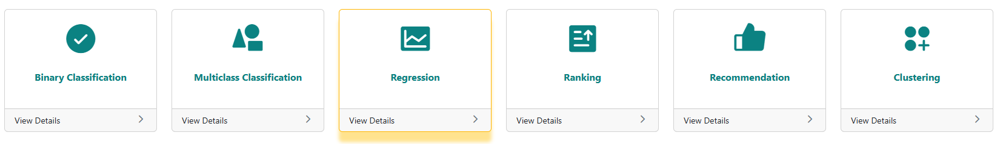
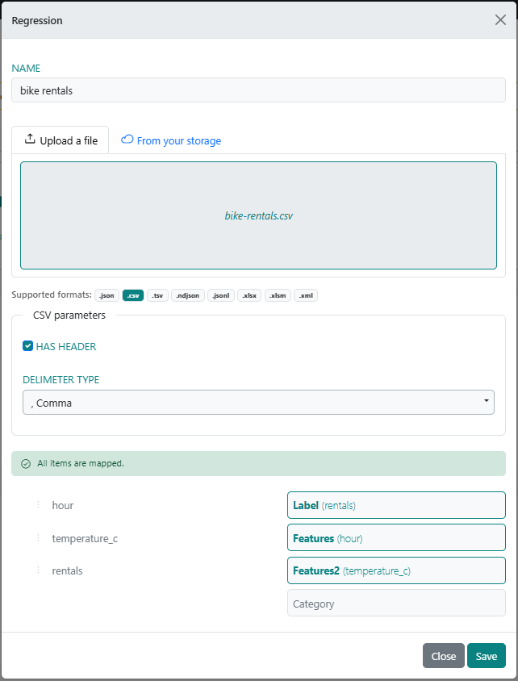
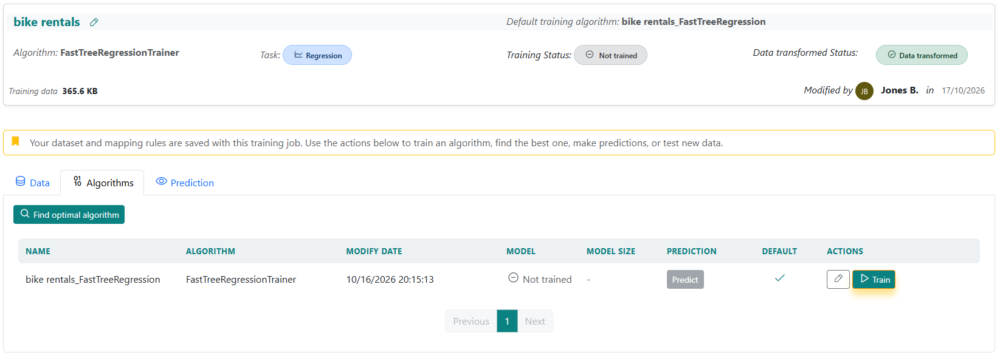
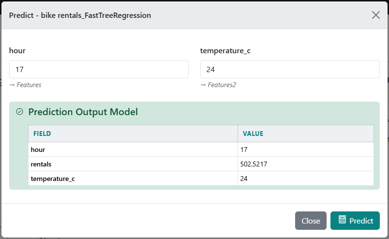
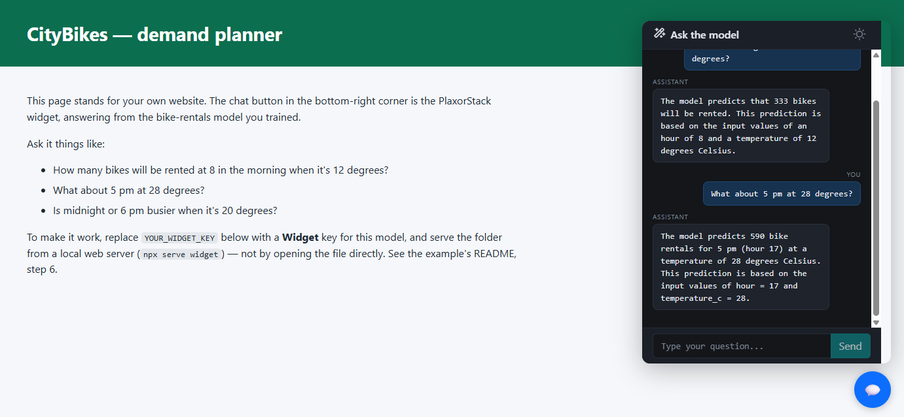

# Forecast bike rentals

**Task:** Regression — predict a number · **Data:** 17,379 hours of a real bike-share scheme ·
**Time:** ~10 minutes · **Also shows:** the chat widget

A bike-share operator needs to know how many bikes will be rented in a given hour, so vans can move
bikes to busy stations before the rush and staff aren't sent out for an empty night. Two things
explain most of the demand: the **time of day** and the **weather**.

The same recipe predicts any quantity: orders per hour, calls to a support line, energy use,
delivery time, a house's price.

## The data

`data/bike-rentals.csv` — every hour of 2011 and 2012 at Capital Bikeshare, Washington D.C.

| Column | Meaning | Example |
|---|---|---|
| `hour` | Hour of the day, 0–23 | `17` |
| `temperature_c` | Air temperature, °C | `24.6` |
| `rentals` | Bikes rented in that hour — **what we predict** | `562` |

```
hour,temperature_c,rentals
0,9.8,16
1,9,40
```

Rentals range from 1 to 977 an hour, 189 on average. Source and licence: [DATA-LICENSES.md](../../DATA-LICENSES.md).

## 1. Upload

1. Sign in at [plaxorstack.com](https://plaxorstack.com) and open **Start training** (the **Training Pipeline** page).
2. Click the **Regression** card.
3. Name it `Bike rentals` and drop in `data/bike-rentals.csv`.



## 2. Match the columns

Drag each column on the left onto its field on the right:

| Your column | Field | Why |
|---|---|---|
| `rentals` | **Label** | The number to predict |
| `hour` | **Features** | First input |
| `temperature_c` | **Features2** | Second input |



Click **Save**.

## 3. Train

Saving opens the training. When the data has been imported, click **Train** in the algorithm's row on
the **Training** tab. It takes a minute or two; the row then shows **Trained**. Not sure which algorithm
to use? **Find optimal algorithm** tries several and keeps the best.



**What to expect:** on a held-out fifth of the data our test run scored **R² ≈ 0.67**, about
**±75 bikes** off on a typical hour. That's good for two inputs. The rest of the variation is
weekday vs weekend, rain and holidays, which this model doesn't see.

## 4. Try it in the browser

Click **Predict** on the trained row and enter:

| hour | temperature_c | You should see about | Why |
|---|---|---|---|
| `17` | `24` | **500–600** | Evening commute in good weather — the busiest hour |
| `8` | `12` | **~300** | Morning commute, cool |
| `13` | `7` | **~80** | Cold midday |
| `3` | `20` | **< 20** | Night |



## 5. Call it from code

Find the model's number on the **AI Board** (it reads **Model #1234**). Create an **API** key at
**Secrets**, then:

```sh
export PLAXOR_API_KEY="your API key"
export PLAXOR_MODEL_ID="1234"
cd api
```

| | Run |
|---|---|
| curl | `sh predict.sh` |
| Python | `python predict.py` |
| JavaScript | `node predict.mjs` |
| C# | `dotnet run predict.cs` |

```
Expected rentals: 503 bikes
```

The request is what you'd expect — your own column names, values as strings:

```json
POST https://api.plaxorstack.com/predict
X-Api-Key: <your API key>

{ "trainingTypeId": 1234, "inputs": { "hour": "17", "temperature_c": "24" } }
```

The answer is in `score`.

## 6. Put it on a web page

`widget/index.html` is a small "demand planner" page with the PlaxorStack chat in the corner.
Visitors ask in plain words — *"how many bikes at 18:00 if it's 25 degrees?"* — and the model answers.



1. **AI Board** → choose this model → connect an LLM and turn chat on.
2. **Secrets** → create a **Widget** key for this model. Leave *Allowed sites* empty for now.
3. In `widget/index.html`, replace `YOUR_WIDGET_KEY` with it.
4. Serve the folder and open the address it prints:

   ```sh
   npx serve widget
   ```

The whole integration is one tag:

```html
<script src="https://plaxorstack.com/js/widget.js"
        data-key="YOUR_WIDGET_KEY"
        data-title="Ask the demand planner"
        defer></script>
```

Before you put it on a real site, list that site's address under *Allowed sites* on the widget key.

## Make it yours

Any table with a number to predict works the same way: pick the two columns that drive it most,
map them to **Features** and **Features2**, and the number to **Label**. If one input is a word
rather than a number (a city, a product type), map it to **Category** instead of Features2.
